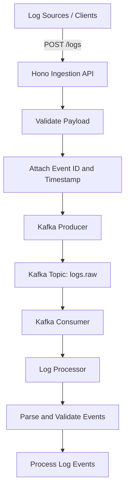

# StreamLog

**A Kafka-powered, event-driven log ingestion and processing pipeline built with Bun, TypeScript, and Hono.**

StreamLog decouples log ingestion from processing using Apache Kafka, creating a foundation for scalable and reliable log-processing infrastructure.

<p align="center">
  
  
  
  
  
</p>

## Overview

StreamLog provides an asynchronous pipeline for accepting and processing log events. Instead of processing every log synchronously inside an HTTP request, the API publishes events to Kafka, allowing a separate consumer to process them independently.

### Key Features

- **HTTP log ingestion** — Accept log events through a Hono API.
- **Event-driven architecture** — Decouple ingestion and processing with Apache Kafka.
- **Partitioned event streaming** — Use Kafka topics and service-based message keys.
- **Asynchronous processing** — Consume and process logs independently of the API.
- **Input validation** — Validate incoming log payloads before publishing.
- **Event metadata** — Attach an event ID and timestamp to accepted logs.
- **Health checks** — Expose an endpoint for checking API health.
- **Graceful shutdown** — Handle service termination cleanly.

## Architecture



### Data Flow

1. A client submits a log event to the ingestion API.
2. The API validates the payload and adds event metadata.
3. The Kafka producer publishes the event to the `logs.raw` topic.
4. Kafka distributes events across the configured partitions.
5. The `log-processor` consumes events asynchronously.
6. The processor parses, validates, and processes the events.

The API returns `202 Accepted` when the event has been accepted for asynchronous processing. This does not necessarily mean the event has completed processing.

## Tech Stack

| Technology | Purpose |
|---|---|
| [Bun](https://bun.sh/) | JavaScript runtime and package manager |
| [TypeScript](https://www.typescriptlang.org/) | Type-safe application development |
| [Hono](https://hono.dev/) | Lightweight HTTP API framework |
| [Apache Kafka](https://kafka.apache.org/) | Distributed event streaming |
| [KafkaJS](https://kafka.js.org/) | Kafka producer and consumer integration |
| [Docker](https://www.docker.com/) | Local infrastructure |

## Project Structure

The following illustrates the logical organization of the application. Adjust the paths to match the repository.

```text
streamlog/
├── apps/
│   ├── api/                 # Log ingestion API
│   └── log-processor/       # Kafka consumer and processor
├── packages/
│   └── shared/              # Shared types and domain logic
├── docker-compose.yml       # Local Kafka infrastructure
├── package.json
├── tsconfig.json
└── README.md
```

## Getting Started

### Prerequisites

Install the following tools:

- [Bun](https://bun.sh/docs/installation)
- [Docker](https://docs.docker.com/get-docker/)
- Git

### 1. Clone the Repository

```bash
git clone <YOUR_REPOSITORY_URL>
cd streamlog
```

### 2. Install Dependencies

```bash
bun install
```

### 3. Start Kafka

Start the local Kafka infrastructure using the repository's Docker Compose configuration:

```bash
docker compose up -d
```

Ensure Kafka is healthy and accessible from the application. The exact broker address depends on your Docker configuration.

### 4. Configure Environment Variables

Create the appropriate `.env` file for your API and processor.

Example configuration:

```env
PORT=3000
KAFKA_BROKERS=localhost:9092
KAFKA_CLIENT_ID=streamlog
KAFKA_TOPIC=logs.raw
```

These are example variable names. Use the actual names expected by your application and keep credentials out of version control.

### 5. Start the Application

Run the API and processor using the scripts defined in their respective `package.json` files.

For example, if your workspace defines these scripts:

```bash
bun run dev
```

Start the processor separately using its configured development script.

> **Note:** The exact commands depend on your workspace scripts and package layout.

## API Reference

### Health Check

`GET /health`

Checks whether the API is responding.

Example:

```bash
curl http://localhost:3000/health
```

### Ingest a Log Event

`POST /logs`

Submits a log event for asynchronous processing.

Example request:

```bash
curl -X POST http://localhost:3000/logs \
  -H "Content-Type: application/json" \
  -d '{
    "service": "payment-service",
    "level": "error",
    "message": "Payment processing failed"
  }'
```

The request fields above are illustrative; use the payload schema implemented by the API.

**Expected behavior:**

- Validate the incoming event.
- Attach event metadata.
- Publish the event to Kafka.
- Return `202 Accepted` when the event is accepted for asynchronous processing.

## Kafka Configuration

| Setting | Value |
|---|---|
| Raw events topic | `logs.raw` |
| Partition count | 6 |
| Message key | `service` |
| Producer | KafkaJS |
| Consumer | `log-processor` |

Using the service name as the message key routes events for the same service to the same partition under a stable partitioning configuration. Kafka preserves order within a partition, not globally across all partitions.

## Design Principles

**Separation of concerns:** The API handles ingestion while the processor handles downstream work.

**Asynchronous processing:** Kafka buffers events between producers and consumers.

**Horizontal scalability:** Partitioned topics provide a foundation for scaling consumer processing, subject to consumer-group and partition limits.

**Reliability first:** Retries, duplicate handling, failure isolation, and monitoring are important next steps toward dependable processing.

## Contributing

Contributions, bug reports, and suggestions are welcome.

1. Fork the repository.
2. Create a feature branch.
3. Make your changes and run the available checks.
4. Open a pull request describing the change.

## License

Choose and add a license file, such as `LICENSE`, before publishing the project for reuse.

---

<p align="center">
  <strong>StreamLog</strong> — Building reliable event-driven log infrastructure.
</p>
